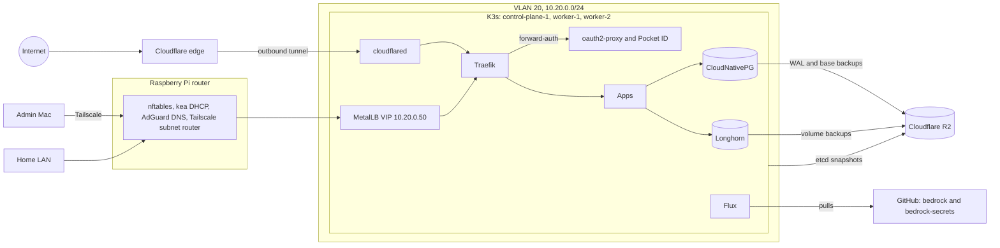

# bedrock

[](https://github.com/lucawalz/bedrock/actions/workflows/nix-check.yaml)
[](https://github.com/lucawalz/bedrock/actions/workflows/k8s-validate.yaml)
[](https://github.com/lucawalz/bedrock/actions/workflows/lint.yaml)
[](https://github.com/lucawalz/bedrock/actions/workflows/docs.yaml)
[](https://fluxcd.io/)
[](https://nixos.org/)
[](LICENSE)

A bare-metal Kubernetes home lab that is rebuilt from Git.

## Description

bedrock is the single source of truth for a small home cluster. Three Lenovo ThinkCentre m920q mini PCs run [NixOS](https://nixos.org/) and [K3s](https://k3s.io/), and a Raspberry Pi running NixOS is the router, gateway and DNS. Hosts are declared as NixOS flakes and applied with `nixos-rebuild`. Cluster state is reconciled by [Flux](https://fluxcd.io/) from `kubernetes/clusters/home`, so a commit to `main` is the only way a change reaches the cluster.

The cluster runs a document archive with LLM tagging, a local LLM stack, a blog, monitoring and the platform behind them. Two hosts are public through a Cloudflare tunnel; everything else is reachable only from the LAN or over Tailscale, behind passkey single sign-on.

In November 2026 the cluster was wiped and rebuilt from this repository to prove that it can be. The measured run and the procedure are in the [disaster recovery runbook](docs/disaster-recovery.md).

### Features

- Every host declared with NixOS flakes, including disk layout ([disko](https://github.com/nix-community/disko)) and host secrets ([agenix](https://github.com/ryantm/agenix)).
- GitOps with Flux under the Flux Operator, ordered by `dependsOn` and checked in CI so a cold bootstrap converges.
- No inbound port from the internet. Public traffic arrives over an outbound Cloudflare tunnel; admins use Tailscale.
- Default-deny NetworkPolicies in every namespace and Kyverno policies in `Enforce` mode.
- Passkey single sign-on through Pocket ID and oauth2-proxy, with the OIDC clients declared in git.
- Off-site backups to Cloudflare R2 for Postgres, Longhorn volumes and etcd, with a restore drill (`just restore-test`) and LUKS-encrypted Paperless and Open WebUI volumes.
- A scaffold, `just new-app`, that writes a self-contained app folder which passes every check.

## Architecture



The network is zoned. The servers sit on VLAN 20 (`10.20.0.0/24`), and VLAN 30 (`10.30.0.0/24`) is a DMZ that the router firewall denies towards the cluster and the home LAN. From the home LAN the router forwards nothing into VLAN 20 except the service VIP `10.20.0.50` on ports 80 and 443 ([ADR 0002](docs/adr/0002-declare-every-host-with-nixos-flakes.md)).

Public traffic never reaches the LAN directly. Cloudflare terminates TLS at its edge, and the tunnel routes only `chat.syslabs.dev` and `lucawalz.dev` to Traefik. Internally, AdGuard on the Pi answers every `*.syslabs.dev` name with the IPv4 service VIP through one wildcard rewrite, public names included, and returns an empty answer for AAAA queries, so clients on the LAN or the tailnet always land on the VIP. cert-manager issues one wildcard certificate over Let's Encrypt DNS-01, so an internal host needs neither a DNS record nor an open port. Devices that do not use the Pi as resolver see only the public records, which exist for the two tunnel hosts ([ADR 0011](docs/adr/0011-serve-through-traefik-and-a-cloudflare-tunnel.md)).

### Hardware

| Node | Role | Address |
| --- | --- | --- |
| control-plane-1 | K3s server with embedded etcd, also runs workloads | 10.20.0.10 |
| worker-1 | K3s agent | 10.20.0.11 |
| worker-2 | K3s agent | 10.20.0.12 |
| router | Raspberry Pi: gateway, firewall, DHCP, DNS, Tailscale subnet router, bar panel kiosk | 10.20.0.1 |

A TP-Link TL-SG108PE carries the VLAN tags and powers the Pi over PoE. The Pi advertises `10.20.0.0/24` to the tailnet, and each node also joins the tailnet as its own `tag:cluster` device, so the nodes stay reachable when the Pi is not ([ADR 0003](docs/adr/0003-run-k3s-as-one-server-and-two-agents-on-the-tailnet.md)). Firmware sits outside Nix and is patched by hand: `rpi-eeprom` on the Pi and the BIOS on the nodes.

## Stack

| Layer | Component | Decision |
| --- | --- | --- |
| Hosts | NixOS flakes, disko, agenix | [ADR 0002](docs/adr/0002-declare-every-host-with-nixos-flakes.md) |
| Kubernetes | K3s, one server and two agents, flannel over Tailscale | [ADR 0003](docs/adr/0003-run-k3s-as-one-server-and-two-agents-on-the-tailnet.md) |
| Cluster CA | Stable CA under an offline root | [ADR 0004](docs/adr/0004-keep-a-stable-cluster-ca-under-an-offline-root.md) |
| GitOps | Flux 2.10 under the Flux Operator | [ADR 0001](docs/adr/0001-reconcile-the-cluster-from-git-with-the-flux-operator.md) |
| Secrets | agenix for hosts, SOPS with age in the private `bedrock-secrets` repository | [ADR 0005](docs/adr/0005-keep-host-secrets-in-agenix-and-cluster-secrets-in-sops.md) |
| Storage | Longhorn, with LUKS-encrypted volumes for Paperless and Open WebUI | [ADR 0006](docs/adr/0006-store-volumes-on-longhorn.md) |
| Databases | One CloudNativePG cluster with per-app roles and databases, barman-cloud plugin | [ADR 0007](docs/adr/0007-share-one-cloudnativepg-cluster-with-per-app-databases.md) |
| Network policy | Default deny, reusable Kustomize components, kube-router enforcement | [ADR 0008](docs/adr/0008-deny-network-traffic-by-default.md) |
| Admission | Kyverno in `Enforce` mode | [ADR 0009](docs/adr/0009-enforce-workload-policy-with-kyverno.md) |
| Identity | Pocket ID with passkeys, oauth2-proxy forward-auth | [ADR 0010](docs/adr/0010-sign-in-through-pocket-id-and-oauth2-proxy.md) |
| Ingress | MetalLB, Traefik, cert-manager, Cloudflare tunnel | [ADR 0011](docs/adr/0011-serve-through-traefik-and-a-cloudflare-tunnel.md) |
| Backups | Cloudflare R2 and restore drills | [ADR 0012](docs/adr/0012-back-up-off-site-to-cloudflare-r2-and-test-restores.md) |
| Apps | Self-contained app folders on the bjw-s app-template chart | [ADR 0013](docs/adr/0013-keep-each-app-self-contained-and-scaffold-new-ones.md) |
| Updates | Pinned versions, Renovate | [ADR 0014](docs/adr/0014-pin-versions-and-update-them-with-renovate.md) |
| Observability | kube-prometheus-stack, Loki, Tempo, Alloy, ntfy, a deadman on the router | [ADR 0015](docs/adr/0015-observe-with-prometheus-loki-and-tempo.md) |

The full record set is indexed in [docs/adr](docs/adr/README.md), and every Helm release with its chart is listed in the generated [inventory](docs/inventory.md).

### Services

| Service | Purpose | Access |
| --- | --- | --- |
| Blog | Static Hugo site, released by Flagger | public (`lucawalz.dev`) |
| Open WebUI | Chat front end for the local models, own login | public (`chat`) |
| Paperless | Document archive, own login | internal (`paperless`) |
| paperless-gpt | Vision OCR and tagging for Paperless with Claude Haiku through LiteLLM | internal, forward-auth (`paperless-gpt`) |
| LiteLLM | OpenAI-compatible gateway in front of Ollama and Anthropic | internal, forward-auth and own login (`litellm`) |
| Homepage | Dashboard and links | internal, forward-auth (`home`) |
| Grafana | Dashboards, own login | internal (`grafana`) |
| Prometheus | Metrics and query browser | internal, forward-auth (`prometheus`) |
| Alertmanager | Alert routing and silences | internal, forward-auth (`alertmanager`) |
| ntfy | Notifications from Alertmanager and Flux | internal, own login (`ntfy`) |
| Flux | Flux Operator web UI | internal, forward-auth and Pocket ID login (`flux`) |
| Longhorn | Storage UI | internal, forward-auth (`longhorn`) |
| Traefik | Router dashboard | internal, forward-auth (`traefik`) |
| Pocket ID | Passkey identity provider | internal (`id`) |
| oauth2-proxy | Forward-auth gate for the admin UIs | internal (`auth`) |
| Zot | Pull-through image cache, no UI | internal (`registry`) |
| AdGuard Home | DNS filtering and the wildcard rewrite, own login | router loopback, `ssh -L 3001:127.0.0.1:3000 root@10.20.0.1` then `http://127.0.0.1:3001` |

Internal names are subdomains of `syslabs.dev`. Ollama serves the local models inside the cluster only. LiteLLM holds the only Anthropic key and gives paperless-gpt a virtual key limited to one model and its own budget.

## Installation

### Requirements

- [Nix](https://nixos.org/download.html) with flakes. `nix develop` pins the toolchain (kubectl, helm, flux, sops, age, just, yq, kubeconform, nixos-rebuild), and the macOS shell adds nixos-anywhere for first installs.
- A GitHub account holding this repository and the private `bedrock-secrets` repository.
- A Tailscale tailnet, a Cloudflare account with the `syslabs.dev` zone, and three R2 buckets (`bedrock-postgres`, `bedrock-longhorn`, `bedrock-etcd`) with one bucket-scoped token each.
- The three recovery keys: the SOPS age key, the K3s root CA (offline only), and the Longhorn volume encryption key. They are kept on an encrypted offline medium ([ADR 0004](docs/adr/0004-keep-a-stable-cluster-ca-under-an-offline-root.md), [disaster recovery](docs/disaster-recovery.md#recovery-seeds)).

### Hosts

1. Router first, because nothing else has a network without it. Flash the `router-installer` SD image, then push the real configuration, which brings up the VLANs, DHCP and DNS.
2. Install NixOS on each node (disko lays out the disk) and push its configuration. control-plane-1 starts K3s with `clusterInit`, and the `k3s-ca` unit installs the stable cluster CA from `secrets/k3s-ca.age` before the first start, so the agents join with the token already in agenix. `scripts/generate-cluster-ca.sh` creates that CA once from the offline root and is not part of a routine rebuild.

```
nixos-rebuild switch --flake .#control-plane-1 --target-host root@10.20.0.10 --build-host root@10.20.0.10
```

### Flux

With three nodes Ready, `just bootstrap` brings Flux up. Each step asks before it runs:

1. Refresh the default kubeconfig entry from control-plane-1 (`just kubeconfig`).
2. Apply CoreDNS from `kubernetes/infrastructure/controllers/coredns`. K3s runs with `--disable=coredns`, and without cluster DNS Flux cannot fetch the repository that installs it.
3. Install the flux-operator chart at the version pinned in its HelmRelease.
4. Apply the `FluxInstance` from `kubernetes/clusters/home/flux-operator/instance/fluxinstance.yaml`.
5. Create the `sops-age` Secret from the cluster age key on the offline stick (`/Volumes/bedrock-keys/bedrock/age-keys.txt` by default, or `SOPS_AGE_KEY_FILE`), after checking that it matches one of the recipients in `.sops.yaml`.
6. Create the sync Secret with a new SSH deploy key, print its public half and register it with `gh` as the read-only deploy key `flux-home-cluster`, or reuse a key from `BEDROCK_DEPLOY_KEY`.
7. Wait for the `FluxInstance` to become Ready.

Three steps stay manual afterwards:

- Delete the previous cluster's deploy key on GitHub. The new key is read-only, since nothing in the cluster writes to git.
- Open `https://id.syslabs.dev/setup` at once, register the owner passkey, and mark the owner email as verified in the Pocket ID admin UI. There is no SMTP, and oauth2-proxy rejects an unverified email with a 500 on every forward-auth login.
- The public DNS records for the tunnel hostnames are made by hand in the Cloudflare dashboard.

Flux then works through `kubernetes/clusters/home/config/` in `dependsOn` order. `flux get kustomizations -A` and `flux get helmreleases -A` show the progress. A cold start takes over an hour, most of it image pulls through the empty zot cache.

## Usage

Day-two operations are `just` recipes; `just --list` prints them with their help text.

| Recipe | What it does |
| --- | --- |
| `just bootstrap` | Bring Flux up on a fresh cluster, confirming each step |
| `just kubeconfig` | Refresh the default kubeconfig entry from control-plane-1 |
| `just reconcile <app>` | Fetch the repository and reconcile the app's Flux Kustomization |
| `just logs <app>` | Follow the logs of every labelled pod in the app's namespace |
| `just login <app> [show=true]` | Show an app's admin login and copy its password, or print it |
| `just psql <app>` | Open psql on the app's database on the CNPG primary |
| `just dump <app>` | Write a `pg_dump` custom-format dump of the app's database |
| `just restore <app> <file>` | Replace the app's database with a dump, with the app suspended and scaled to zero |
| `just backup` | Take an on-demand CNPG backup to R2 and wait for it |
| `just restore-test [postgres\|longhorn\|etcd\|dumps\|all]` | Run the restore drills; `--dry-run` prints and validates the manifests |
| `just new-app ...` | Scaffold an app, see below |
| `just new-secret <app>` | Create the app's encrypted secrets in `bedrock-secrets` with random values |
| `just paperless-import <dir>` | Copy a local folder of scans into the Paperless consume folder |
| `just encrypt-volumes <app>` | Copy an app's volumes onto encrypted twins before its claims are swapped; add `--dry-run` to print the copy pod |
| `just deploy-nodes` | Rebuild worker-2, worker-1, control-plane-1 and the router in order, stopping at the first host that fails to come back Ready and healthy; add `--dry-run` to print the steps |
| `just luks-discards <namespace>/<pvc>` | Store allow-discards in an attached encrypted volume's LUKS2 header and trim it |
| `just email-gate-deploy` | Deploy the Cloudflare Worker that gates the Paperless mail address by sender |

### Changing a host

```
nixos-rebuild switch --flake .#worker-1 --target-host root@10.20.0.11 --build-host root@10.20.0.10
```

`--build-host` is required. An arm64 Mac can produce neither the x86_64-linux closure the nodes need nor the aarch64-linux closure the router needs, so the build runs on control-plane-1, which also emulates aarch64 for the router. During a cold rebuild, before control-plane-1 exists, point `--build-host` at the target itself. Do not prefix the command with `sudo`: nothing is built or activated locally, and sudo moves `$HOME` to `/var/root`, which holds no SSH key for the cluster.

On macOS the `TMPDIR` inside `nix develop` is long enough that the SSH control socket nixos-rebuild creates there exceeds the Unix socket path limit and the connection fails with `unix_listener: ... too long for Unix domain socket`. Run the command with a short `TMPDIR` instead:

```
mkdir -p /tmp/nr
TMPDIR=/tmp/nr nix develop --command env TMPDIR=/tmp/nr nixos-rebuild switch --flake .#control-plane-1 --target-host root@10.20.0.10 --build-host root@10.20.0.10
```

A router rebuild restarts tailscaled, which cuts any session through the Pi's subnet route, so router changes are pushed through control-plane-1's own tailnet address with an SSH config file passed as `NIX_SSHOPTS="-F <config file>"`; the [disaster recovery runbook](docs/disaster-recovery.md#wipe-and-rebuild-the-nodes) has the config and the command.

Deploy hosts with `just deploy-nodes` within a week of a merged flake lock bump. A kernel change needs a drained reboot of each host, one at a time, after the rebuild.

### Adding an app

```
just new-app <name> <host> <port> db=true sso=true image=<repository>:<tag>
```

The scaffold writes `kubernetes/apps/<name>/` with its namespace, Flux Kustomizations and Alert, an app-template HelmRelease, an IngressRoute, network policies, forward-auth when `sso=true`, and a CNPG role and database when `db=true`. It adds the app to `kubernetes/apps/kustomization.yaml`, regenerates `docs/inventory.md` and runs every repository check, then prints the remaining steps. With `db=true`, `just new-secret <name>` creates `pg-<name>` and `<name>` in `bedrock-secrets` with random values. Commit both repositories, and Flux applies the app on its next pass ([ADR 0013](docs/adr/0013-keep-each-app-self-contained-and-scaffold-new-ones.md)).

Namespaces carry `kustomize.toolkit.fluxcd.io/prune: disabled`, so removing an app from the index leaves its namespace and volumes until a deliberate `kubectl delete namespace`.

## Repository layout

```
flake.nix              every host and the dev shells
lib/                   the node inventory and the builder that generates the cluster nodes
hosts/                 shared base, control-plane-1, the router and the router installer image
modules/
  k3s/                 server and agent roles, plus the dormant cloud node image
  router/              firewall, DHCP, DNS, deadman and the bar panel kiosk
  tailscale/           the tailnet client
  services/            host prerequisites for Longhorn
secrets/               agenix-encrypted host secrets, recipients in secrets.nix
kubernetes/
  clusters/home/       the cluster entrypoint: Flux Kustomizations, FluxInstance, namespaces, sources
  infrastructure/      the platform: controllers/ (installs) and configs/ (their custom resources)
  components/          shared Kustomize components (network policies, forward-auth, dependency wait)
  apps/                one self-contained folder per app
cloudflare/            the email gate Worker
tailscale/             the tailnet access policy, pasted into the admin console
infra/packer/          the dormant Packer template for a cloud node snapshot
scripts/               bootstrap, scaffold, restore drills and the CI checks
tests/                 Kyverno policy tests and promtool alert-rule tests
docs/                  ADRs, the inventory and the runbooks
```

## Recovery

Recovery depends on the repositories, the three offline keys and the R2 buckets. The [disaster recovery runbook](docs/disaster-recovery.md) covers the measured rebuild, restores from R2, the drill cadence and the known gaps. The [admission break-glass runbook](docs/admission-break-glass.md) covers a webhook that blocks the writes needed to repair it, and the [alert selector audit](docs/alert-selector-audit.md) covers the live check of alert rules.

## Continuous integration

Every pull request and push to `main` runs:

- `nix-check`: `nixfmt`, `statix`, `deadnix`, `nix flake check` and a build of every cluster node. `nix-build-router` builds the router closure on an arm64 runner when router files change, and weekly.
- `k8s-validate`: kubeconform against upstream and CRD schemas, `kustomize build` of every kustomization, a render of every HelmRelease, a render of the Flux Kustomizations with their substitutions, the Kyverno policy tests, the promtool rule tests, a check that SOPS files are encrypted, and the repository checks in `scripts/check-*.sh` (CRD order, CRD-only charts, HelmRelease retry strategy, apps index, Helm sources, alert namespaces, default ServiceAccounts, snapshot coverage).
- `lint`: shellcheck and actionlint.
- `docs`: the ADR index and the generated inventory.
- `renovate-validate`: the Renovate configuration.

`image-scan` runs weekly and on demand instead: Trivy scans every image the cluster runs for critical vulnerabilities with a fix, and one GitHub issue lists them.

`scripts/check-alert-selectors.sh` needs the live Prometheus and is run by hand after rule changes and rebuilds ([alert selector audit](docs/alert-selector-audit.md)). [Renovate](https://docs.renovatebot.com/) keeps the pins current ([ADR 0014](docs/adr/0014-pin-versions-and-update-them-with-renovate.md)).

## Roadmap

- strata, a project that builds on Paperless, CloudNativePG, the tunnel and the off-site backups.
- Tunnel DNS records managed from git instead of the Cloudflare dashboard.
- Migration from Traefik IngressRoutes to the Gateway API.
- A rebuild that reinstalls the operating system with disko, not only the K3s state.
- An immutable off-site vault for irreplaceable data (documents, passwords, photos) at Hetzner, before photos move onto the cluster.

The roadmap is a direction, not a commitment.

## Contributing

This is a personal home lab, not a product, but issues and forks are welcome. Anyone reusing the layout will need to adapt it to their own hardware, domain and accounts.

To work on it, enter the dev shell with `nix develop` and run `nix flake check` and `scripts/check-*.sh` before opening a pull request. Report security issues as described in [SECURITY.md](SECURITY.md).

## Support

Open an issue on the [GitHub repository](https://github.com/lucawalz/bedrock/issues).

## Authors and acknowledgment

Built and maintained by Luca Walz. It stands on open-source work, in particular NixOS, K3s, Flux, disko, agenix, SOPS, Longhorn, CloudNativePG, Kyverno, Pocket ID, Traefik, and the chart maintainers behind the services it runs.

## License

Released under the MIT License. See [LICENSE](LICENSE).

## Project status

Actively maintained and running at home. Rebuilt from git in November 2026.
